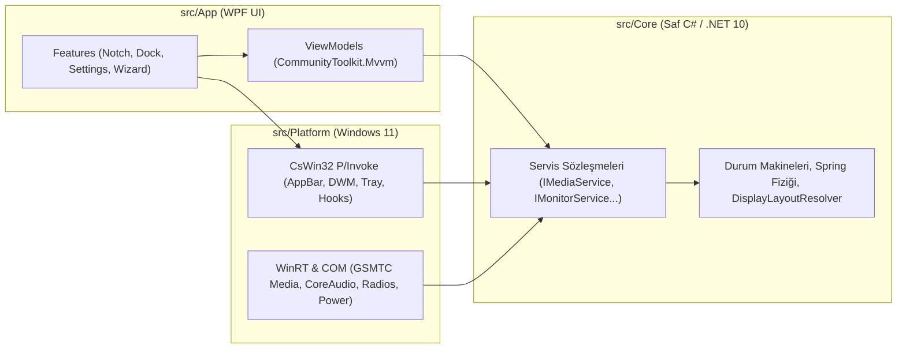

<div align="center">

<picture>
  <source media="(prefers-color-scheme: dark)" srcset="assets/branding/dist/koy-horizontal-white-800.png">
  <source media="(prefers-color-scheme: light)" srcset="assets/branding/dist/koy-horizontal-color-800.png">
  
</picture>

<br />
<br />

**Windows 11 için hafif, yay fiziği animasyonlu Çentik (Notch) ve Seelen UI modelinde Dock.**  
*Lightweight, zero-browser, spring-animated Notch & Dock for Windows 11.*

[](https://github.com/brhnshn/koy/actions/workflows/ci.yml)
[](https://github.com/brhnshn/koy/releases/latest)
[-0078D4)](https://github.com/brhnshn/koy)
[](https://dotnet.microsoft.com/)
[](LICENSE)

[İndir (Releases)](https://github.com/brhnshn/koy/releases/latest) · [Mimari & Plan](docs/PLAN.md) · [Arayüz Tasarımı](docs/DESIGN.md) · [Katkıda Bulun](CONTRIBUTING.md) · [English Summary](#-english-overview)

</div>

---

## Neden Koy?

Masaüstü özelleştirme araçlarının çoğu (Electron, Tauri veya WebView2 tabanlı olanlar) her pencere için ayrı bir tarayıcı süreci başlatarak yüzlerce megabayt RAM ve sürekli arka plan işlemcisi tüketir.

**Koy**, sıfır tarayıcı bağımlılığıyla doğrudan **.NET 10, WPF, WinRT ve CsWin32** üzerine inşa edilmiştir:

| Özellik | Koy | Tarayıcı Tabanlı Alternatifler (WebView2 / Electron) |
| :--- | :--- | :--- |
| **Çalışma Modeli** | **Tek süreç (`Koy.exe`)**, paylaşımlı kaynaklar | Pencere başına ayrı tarayıcı alt süreçleri |
| **Çizim Motoru** | **Yazılımla çizim (`SoftwareOnly`)** — GPU sürücü şişkinliği (~135 MB) yok | Sürekli GPU kompozisyonu ve VRAM tüketimi |
| **Boşta İşlemci (`Idle CPU`)** | **%0 CPU** — `Spring` durunca `CompositionTarget.Rendering` çözülür | Sürekli çalışan CSS/JS zamanlayıcıları |
| **Servis Yaşam Döngüsü** | **Tembel (Lazy) ilklendirme** — paneller açılana kadar ağ/COM kurulmaz | Açılışta tüm servislerin yüklenmesi |
| **Görev Çubuğu Güvenliği** | Çökme, güncelleme ve kaldırma anında **otomatik kurtarma (`Restore`)** | Süreç öldürüldüğünde görev çubuğunun kaybolması |

---

## Temel Özellikler

### 1. Yay Animasyonlu Çentik (Notch) & OSD HUD
Ekranın üst ortasında (`Top = 0`), içbükey (*concave*) üst kulaklara sahip özel `NotchShape` vektör geometrisiyle konumlanır:
- **Boşta Durum (236×34 px):** Solda saat, sağda pil yüzdesi. Müzik çalarken solda albüm kapağı (22×22 px), sağda **%0 CPU** harcayan 4 çubuklu dalga ikonu.
- **OSD HUD Göstergeleri (260×40 px):** Sistem sesi veya ekran parlaklığı değiştiğinde 1,5 saniye boyunca çentikte beliren akıcı gösterge (ses için beyaz `#F4F4F5`, parlaklık için sarı `#FACC15`).
- **Genişleyen 5 Sekmeli Panel (640 px):**
  - **Müzik:** `GlobalSystemMediaTransportControls` ile Spotify, YouTube (Edge/Chrome/Firefox) ve medya oynatıcılar için kapak resmi, şarkı/sanatçı bilgisi, interaktif zaman çubuğu (`Seek`) ve çoklu oturum geçişi.
  - **Takvim & Pomodoro:** Pazartesi başlangıçlı ay görünümü, yerel zamanlayıcı, kronometre ve çalışma/kısa mola/uzun mola durum makineli **Pomodoro** sayacı (süre bitiminde yay titreşimli Peek bildirimi).
  - **Raf (Shelf):** Dosya veya metinleri çentiğe sürükleyip bırakma (`%AppData%\Koy\shelf.json`). Bir dosyayı çentiğin üzerine sürüklediğinizde çentik kendiliğinden açılır ve Raf sekmesine geçer.
  - **Kontrol Merkezi:** CoreAudio ses seviyesi, WMI (dahili) ve DDC/CI (harici monitör) donanım parlaklık kaydırıcıları, Wi-Fi ve Bluetooth radyo anahtarları, Rahatsız Etme durumu.
  - **Durum:** Pil yüzdesi, şarj durumu ve API anahtarsız **Open-Meteo** hava durumu (30 dk önbellekli).

### 2. Seelen UI Modelinde Dock
Windows görev çubuğunun sıradan bir kopyası değildir; saat, pil ve ağ göstergelerini çentiğe devrederek yalnızca uygulama ve pencere yönetimine odaklanır:
- **İki Yerleşim Stili:**
  - **Yüzen Kapsül (Floating Capsule — Varsayılan):** 60 px yükseklik, alttan 10 px yukarıda, 18 px köşe yuvarlaklığı. Düzen: *Başlat → Uygulamalar (nokta/çizgi göstergeli) → Ayırıcı → Klasörler (İndirilenler) & Küçültülmüş Pencereler → Ayırıcı → Koy Menüsü*.
  - **Tam Genişlik Cam (Full-Width Glass):** 44 px yükseklik. Solda çalan medya hapı, ortada uygulamalar (aktif pencere adıyla hap biçiminde), sağda Koy simgesi.
- **Pencere Yaklaşma Davranışları (`DockProximityMode`):**
  - **Çekil / Akıllı Gizlenme (`Dodge` — Varsayılan):** Pencere yaklaştığında veya büyütüldüğünde dock ekranın altına çekilir; fare alt kenara indiğinde geri gelir.
  - **Yer Ayır (`ReserveSpace`):** `SHAppBarMessage` ile çalışma alanından 46 px yer ayırır; büyütülmüş pencereler tam dock'un üstünde biter.
  - **Hep Gizli (`AlwaysHidden`):** Yalnızca fare ekranın alt kenarına geldiğinde görünür.
- **Canlı DWM Pencere Önizlemesi:** Simgenin üzerinde 400 ms durulduğunda `DwmRegisterThumbnail` ile gerçek zamanlı pencere önizlemesi.
- **Z-Order Kararlılığı:** Alt+Tab ile pencereler arasında geçiş yaparken sabitlenmemiş açık uygulama simgelerinin sırası zıplamaz (`_stableUnpinnedOrder`).

### 3. Çoklu Ekran (Multi-Monitor) İzolasyonu
- **Ekran Başına Pencere & DPI:** Her monitör kendi `NotchWindow` ve `DockWindow` örneğine sahiptir ve o ekranın Per-Monitor DPI ölçeğine göre net çizilir.
- **Bağımsız Tam Ekran Algılama:** Yan ekranda tam ekran bir oyun veya video açıldığında **yalnız o ekrandaki Koy gizlenir**; ana ekrandaki Çentik ve Dock kesintisiz çalışmaya devam eder (`Win+Shift+S` ekran alıntısı aracı filtreli).
- **Dinamik Tak-Çıkar (`WM_DISPLAYCHANGE`):** Monitör bağlandığında, çıkarıldığında veya çözünürlük değiştiğinde pencereler otomatik oluşturulur ve yeniden yerleşir.
- **İkincil Görev Çubukları:** Çoklu ekranda hem ana (`Shell_TrayWnd`) hem de ikincil (`Shell_SecondaryTrayWnd`) Windows görev çubukları senkron yönetilir.

### 4. Koy Penceresi, Sağ Alt Menü & İlk Kurulum Sihirbazı
- **880 px Koy Penceresi:** Sekiz modüler ayar sayfası (*Genel, Çentik, Dock, Ekranlar, Görünüm, Kısayollar, Performans, Hakkında*). Pencereyi kapatmak Koy'u sonlandırmaz; yalnızca ayar görünümünü gizler.
- **Acil Durum Görev Çubuğu Kurtarma:** *Dock* ve *Hakkında* sayfalarında Windows görev çubuğunu tek tıkla geri getiren acil durum düğmesi.
- **Sağ Alt Sistem Menüsü (320 px):** Çentik ve Dock'u anında açıp kapatma, Koy penceresini açma, **1 saat duraklatma** ve uygulamadan tam çıkış.
- **Canlı Çoklu Dil (TR / EN):** Uygulamayı yeniden başlatmadan Türkçe ve İngilizce arasında anında geçiş.

---

## Kurulum ve Doğrulama

### Hazır Kurulum Paketi (Önerilen)
1. [**GitHub Releases**](https://github.com/brhnshn/koy/releases/latest) sayfasından en son sürümü indirin:
   - **`Koy-win-Setup.exe`**: Velopack tek tıkla kurulum paketi (otomatik güncelleme destekli).
   - **`Koy-win-Portable.zip`**: Kurulum gerektirmeyen taşınabilir arşiv.
2. İndirdiğiniz dosyanın bütünlüğünü `SHA256SUMS.txt` ile doğrulayabilirsiniz:
   ```powershell
   Get-FileHash .\Koy-win-Setup.exe -Algorithm SHA256
   ```

> **Windows SmartScreen Notu:** Koy açık kaynaklıdır ve henüz ücretli bir EV sertifikasıyla imzalanmamıştır. İlk çalıştırmada Windows SmartScreen uyarısı görürseniz **"Ek bilgi" (More info) → "Yine de çalıştır" (Run anyway)** seçeneğine tıklayabilirsiniz.

### Kaynak Koddan Derleme

**Gereksinimler:** Windows 11 (22H2 / Derleme 22621+) ve [.NET 10 SDK](https://dotnet.microsoft.com/download/dotnet/10.0)

```powershell
# 1. Depoyu klonlayın
git clone https://github.com/brhnshn/koy.git
cd koy

# 2. Derleyin ve 193 birim testini çalıştırın
dotnet build Koy.slnx -c Release -warnaserror
dotnet test Koy.slnx -c Release

# 3. Uygulamayı başlatın
dotnet run --project src/App

# 4. (İsteğe bağlı) Velopack kurulum ve Portable ZIP paketlerini üretin
powershell -ExecutionPolicy Bypass -File scripts\pack.ps1 -Version 0.1.0
```

---

## Mimari

Koy, katman sınırlarının derleme zamanında korunduğu üç katmanlı bir mimari kullanır:



```text
koy/
├── src/
│   ├── Core/          # Saf C# (net10.0). WPF, Win32 ve WinRT YOK. Yay fiziği, durum makineleri, ayarlar.
│   ├── Platform/      # Windows 11 API uygulamaları (CsWin32 NativeMethods.txt & WinRT). WPF YOK.
│   └── App/           # WPF arayüzü, ince ViewModel'ler, 8 sayfalı KoyWindow, vektör ikonlar ve .resx dil dosyaları.
├── tests/
│   └── Core.Tests/    # xUnit birim testleri (193 test: Spring, NotchController, DockPositionResolver, Pomodoro vb.).
├── assets/branding/   # Koy Rozeti (Konsept C) vektör SVG, PNG ve çok katmanlı ICO marka varlıkları.
├── docs/              # PLAN.md, DESIGN.md, ROADMAP.md, MEMORY.md ve çevrimdışı tasarım galerisi.
└── scripts/           # pack.ps1 (Velopack paketleyici) ve measure-memory.ps1 (bellek ölçüm betiği).
```

---

## Belgeler ve Rehberler

- [**Mimari ve Teknoloji Planı (`docs/PLAN.md`)**](docs/PLAN.md)
- [**Arayüz Tasarım Belgesi (`docs/DESIGN.md`)**](docs/DESIGN.md) & Çevrimdışı Galeri (`docs/design/index.html`)
- [**Yol Haritası (`docs/ROADMAP.md`)**](docs/ROADMAP.md)
- [**Bellek Ölçüm Kayıtları (`docs/MEMORY.md`)**](docs/MEMORY.md)
- [**Katkıda Bulunma ve Kod Yazım Kuralları (`CONTRIBUTING.md`)**](CONTRIBUTING.md)
- [**Değişiklik Günlüğü (`CHANGELOG.md`)**](CHANGELOG.md)
- [**Güvenlik Politikası (`SECURITY.md`)**](SECURITY.md)

---

## English Overview

**Koy** is an ultra-lightweight, native **Notch** and **Dock** for Windows 11 built with **C# (.NET 10) and WPF**. Unlike Electron or Tauri/WebView2 alternatives that spawn multiple browser processes, Koy runs in a **single process** with software rendering (`RenderMode.SoftwareOnly`), consuming **0% CPU when idle** and keeping memory footprint minimal.

- **Spring-Animated Top Notch:** Shows clock & battery when idle (236×34 px), album art & static waveform when playing music, 1.5s OSD HUD overlays for volume and brightness (260×40 px), and expands into 5 panels (*Music with GSMTC session switcher, Calendar & Pomodoro timer, Drag-and-Drop File/Text Shelf, Control Center, and Weather/Battery Status*).
- **Seelen-Style Dock:** Choose between **Floating Capsule** (60 px) or **Full-Width Glass** (44 px) layouts, with intelligent window proximity modes (*Dodge / Intellihide*, *Reserve Space via AppBar*, *Always Hidden*), live 400ms DWM window thumbnail previews (`DwmRegisterThumbnail`), and rock-solid Windows taskbar recovery (`TaskbarService.Restore()`).
- **True Multi-Monitor Support:** Independent per-monitor DPI scaling and per-monitor fullscreen isolation (playing a fullscreen game or video on your secondary monitor only hides Koy on that display).
- **Bilingual UI:** Instant runtime switching between **English** and **Turkish**.

---

## Lisans (License)

Bu proje **GNU General Public License v3.0 (GPLv3)** altında lisanslanmıştır. Ayrıntılar için [`LICENSE`](LICENSE) dosyasına bakın.
